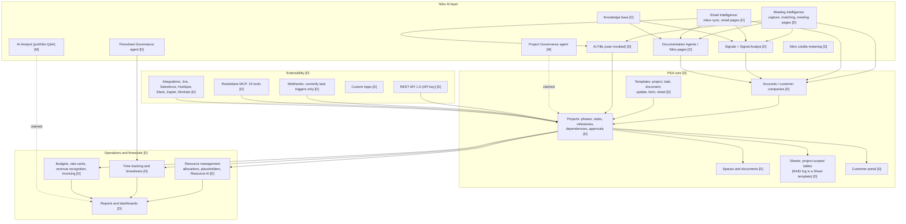
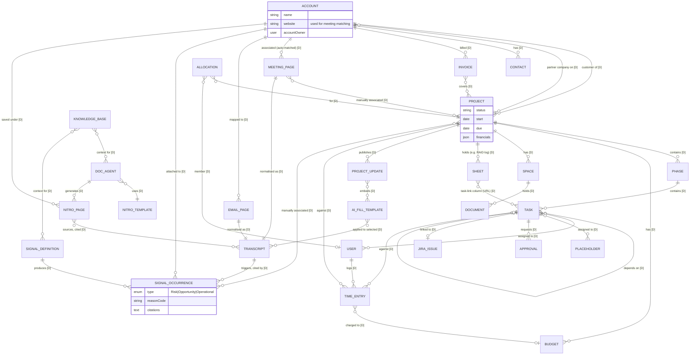
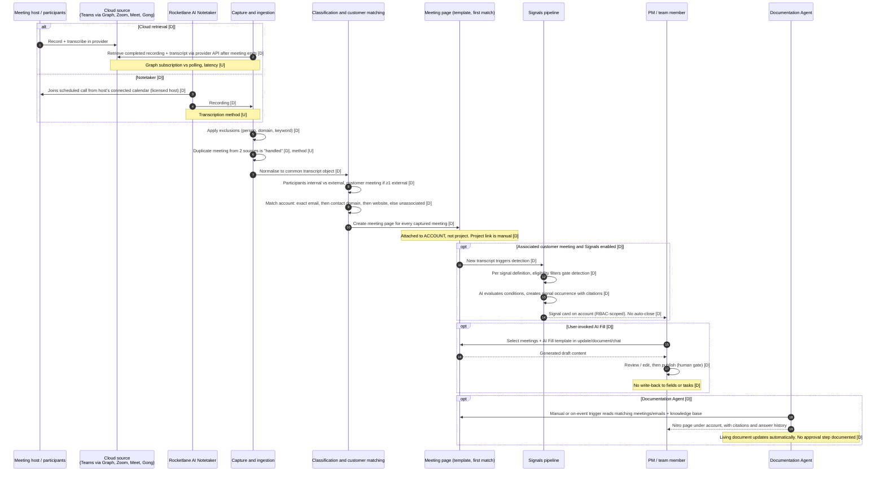
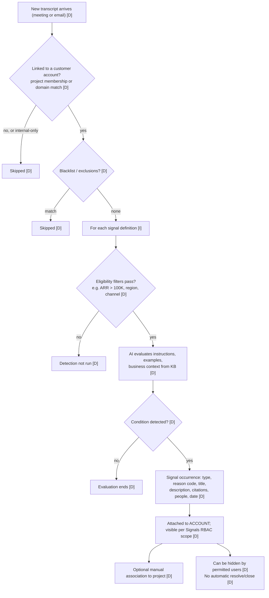
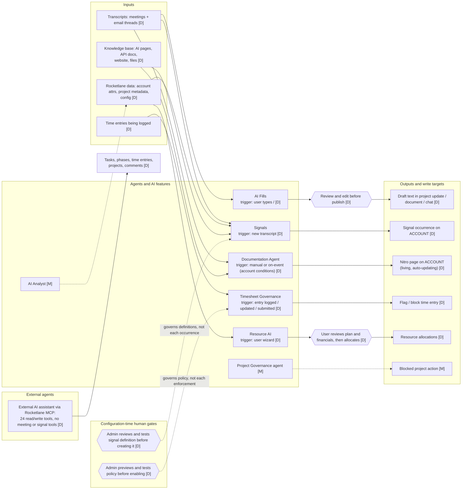

# Deliverable 1: Rocketlane functional and logical architecture

**Scope:** reconstruction from Rocketlane's public documentation only. No logged-in access, no source code, no guesses about private implementation.
**Sources captured:** 2026-10-31 (UTC). 515 pages saved with retrieval time and SHA-256 hash:
- all 410 help-centre articles
- all 103 developer-documentation pages
- 2 blog posts

**Evidence:** 80 ledger rows (`ledger/d1-evidence-ledger.csv`). Each claim below cites a ledger ID such as **[D1-033]**, and each ID carries the source URL, retrieval time and verbatim quote.

## Evidence grades

| Grade | Meaning here |
|---|---|
| **CONFIRMED** | The statement appears in an official help or developer page that I saved and read |
| **DOCUMENTED BEHAVIOUR** | Official docs explain the mechanism: steps, triggers, inputs, outputs |
| **VENDOR CLAIM** | Asserted in marketing (rocketlane.com blogs) with no documented mechanism |
| **INFERRED** | My reconstruction; the reasoning is written in the ledger row |
| **UNKNOWN** | Not public; the ledger row says what was searched |

| Grade | Ledger rows |
|---|---|
| CONFIRMED | 29 |
| DOCUMENTED BEHAVIOUR | 33 |
| VENDOR CLAIM | 4 |
| INFERRED | 7 |
| UNKNOWN | 7 |
| **Total** | **80** |

---

## 1. Summary of findings

1. **The central business entity for AI and interaction data is the Account, not the Project.** CONFIRMED.
   - The docs say "At its core, Rocketlane organizes your work around the Account" [D1-001].
   - Meetings, emails, signals and Nitro pages attach to the account [D1-033, D1-052].
   - Projects are the central entity for delivery work: phases, tasks, time, budgets and invoices [D1-004 to D1-010].
2. **Meeting intelligence is not attached to projects.** CONFIRMED. The vendor states this itself:
   - "Transcripts are currently associated only with accounts, not projects."
   - Linking meetings and signals to projects is manual [D1-033].
   - Your brief's premise is correct.
3. **Your premise that "AI output isn't written back as records" is mostly correct, with one exception:**
   - AI Fills doesn't write back to the project field it draws choices from [D1-043] (CONFIRMED).
   - No documented in-product path turns AI action items into tasks [D1-017] (INFERRED, because it rests on an absence).
   - Signals stay on the account, with no automatic close [D1-047].
   - **Exception:** Nitro page templates include a **Record Block** "designed for structured records that persist and update across meetings, such as a running risks log" [D1-053]. Whether those rows can be queried outside the Nitro page (API, MCP, reports) is UNKNOWN. No API or MCP access to them is documented [D1-014, D1-070].
4. **RAID is a Sheet, not a dedicated object.**
   - The help centre documents RAID logs and risk registers as **Sheets** use cases: project-scoped tables built from a template [D1-012].
   - No typed RAID entity is documented [D1-015] (INFERRED, because it rests on an absence).
   - Sheets do offer a "Task link" column, a URL to a task [D1-016].
   - Not documented: the marketing claims that the project plan "reflects" overdue RAID dependencies automatically [D1-013], and that agents create "draft entries for PM review and one-click confirmation" [D1-054].
5. **Governance enforcement is documented only for timesheets.**
   - The Timesheet Governance agent flags or blocks time entries [D1-055], DOCUMENTED BEHAVIOUR.
   - Blocking project actions (stage gates, closure rules, task order) appears only in marketing [D1-056]; no help article covers it [D1-057].
6. **Human control sits mostly at configuration time, not on each AI output** [D1-090]:
   - **Reviewed by a person before it takes effect:** AI Fill output (before publishing); Resource AI allocations.
   - **Set up by a person, then automatic:**
     - Signal definitions (reviewed and optionally tested); occurrences are then raised automatically.
     - Timesheet policies (previewed; off until enabled); enforcement is then automatic.
   - **Automatic, with no per-output step:**
     - meeting and email page generation
     - signal occurrences
     - living-document Nitro page updates
     - on-event agent runs
   - A Documentation Agent's manual trigger starts a run; it doesn't review the output.
7. **The developer surface excludes the AI layer.**
   - The saved REST API reference (79 endpoints; not exhaustive), the webhooks (currently task triggers only) and the 24-tool MCP server expose no meetings, transcripts, signals, AI pages, Nitro pages or Sheets [D1-014, D1-070, D1-076].
   - **Practical effect:** no documented interface lets external systems read or act on Rocketlane's AI output.

---

## 2. Major modules and responsibilities

*Source: `diagrams/01-functional-modules.mmd` · rendered: `diagrams/rendered/01-functional-modules.svg`*

| Module | Responsibility | Evidence |
|---|---|---|
| Accounts | Customer company record: fields, notes, owner, website, people, engagement, financials. Hub for interaction data | D1-001, D1-003 |
| Projects | Delivery container: customer, owner, status, dates, templates, team and customer members, visibility, financial settings | D1-004 |
| Plan: phases and tasks | Phases → tasks → subtasks; dependencies (finish-to-start by default; others optional); milestones; at-risk flag; baselines; critical path | D1-005, D1-006 |
| Spaces, documents, approvals | Project documents, private or shared; approval requests on tasks and documents | D1-010, D1-011 |
| Sheets | Project-scoped structured tables from sheet templates. Documented uses include RAID logs, risk registers, requirements and UAT; columns can include a task link | D1-012, D1-015, D1-016 |
| Resource management | Allocations of members or placeholders to projects and tasks; Resource AI planning wizard | D1-008, D1-060 |
| Time tracking | Time entries with submit, approve and reject workflow; bill and cost rates; categories | D1-007 |
| Financials | Budgets, rate cards, revenue recognition, invoices with line items and payments | D1-009 |
| Meeting Intelligence | Capture, classify, match, meeting pages | D1-020 to D1-035 |
| Email Intelligence | Per-user inbox sync, thread-level email pages, account mapping | D1-036 |
| AI Fills | User-invoked generation into updates, documents and chat | D1-040 to D1-043 |
| Signals | Natural-language-defined detectors producing account-level occurrences | D1-044 to D1-048 |
| Documentation Agents | Template-driven generation of account-level Nitro pages, optionally living | D1-050 to D1-053 |
| Timesheet Governance | Natural-language time-entry policies | D1-055 |
| Developer surface | REST API, webhooks, MCP, custom apps, integrations | D1-070 to D1-086 |

---

## 3. Central entity and relationships

*Source: `diagrams/02-conceptual-er.mmd` · rendered: `diagrams/rendered/02-conceptual-er.svg`*

**How the core entities relate:**
- **Customer → project:** one account or customer company has many projects; partner companies can also be attached [D1-002].
- **Project → plan:** a project has phases; a phase has tasks; tasks nest as subtasks and depend on each other [D1-005, D1-006].
- **Resources:** allocations tie a member or a placeholder role to a project, budget and tasks [D1-008].
- **Time:** a time entry is logged by a user against a project, and optionally a phase, task and budget, then goes through submit, approve or reject [D1-007].
- **Meetings:** a meeting page is auto-matched to an account; any link to a project is manual [D1-033].
  - Meeting and email transcripts share one normalised transcript object [D1-032].
  - Signal occurrences reference transcripts by citation and attach to the account [D1-044, D1-045].
- **Tasks and commitments:** action items exist as generated text in AI Fills or Nitro pages. No documented in-product path turns them into task records [D1-017]. The MCP's "create tasks from meeting notes" needs an external AI assistant to supply the notes [D1-072].
- **Meeting matching inconsistency:** the matching article says a matched meeting appears in "relevant project context", but doesn't say how that context is chosen. That sits uneasily with the manual project link [D1-033].
- **Account vs company:** "Account" in the UI and "company" in the API are treated as one entity. That is INFERRED [D1-003].

---

## 4. Meeting pipeline, end to end

*Source: `diagrams/03-meeting-pipeline-sequence.mmd` · rendered: `diagrams/rendered/03-meeting-pipeline-sequence.svg`*

| Stage | What happens | Grade | Evidence |
|---|---|---|---|
| **Capture: cloud** | After the meeting ends, Rocketlane pulls the recording and transcript through the provider's API (Teams via Microsoft Graph, Zoom, Google Meet, Gong). No bot is needed, and participants don't need Rocketlane licences | DOCUMENTED BEHAVIOUR | D1-021, D1-023 |
| **Capture: notetaker** | A bot joins scheduled calls on a licensed host's connected calendar | DOCUMENTED BEHAVIOUR | D1-022 |
| **Teams prerequisites** | Microsoft 365 admin consent; a Teams application access policy; cloud recording and transcription enabled in meeting policies; ad hoc meetings included | DOCUMENTED BEHAVIOUR | D1-023, D1-024 |
| **Graph mechanism** | Change-notification subscription vs polling; exact permissions | **UNKNOWN** | D1-025 |
| **Exclusions** | Person, domain or keyword rules stop capture; forward-only | DOCUMENTED BEHAVIOUR | D1-035 |
| **De-duplication** | The same meeting from two sources is "handled"; method not described | **UNKNOWN** | D1-026 |
| **Normalisation** | Meeting and email become one common transcript object | DOCUMENTED BEHAVIOUR | D1-032 |
| **Classification** | Internal vs external participants; one external participant makes it a customer meeting | DOCUMENTED BEHAVIOUR | D1-027 |
| **Customer matching** | Exact email → contact domain → company website; an ambiguous result stays unassociated | DOCUMENTED BEHAVIOUR | D1-028 |
| **Matching inconsistency** | Three descriptions disagree: • two articles list company names as an input • the matching article excludes name matching • the Signals article links transcripts to accounts by project membership or Account domain fields | CONFIRMED (inconsistency) | D1-029 |
| **Meeting page** | Created for every captured meeting; template chosen by the first condition match | DOCUMENTED BEHAVIOUR | D1-030, D1-031 |
| **AI extraction** | AI Fills (user-invoked), Signals (automatic), Documentation Agents (manual or on event) | DOCUMENTED BEHAVIOUR | D1-040 to D1-051 |
| **Signals** | Account-level, cited, scoped by role permissions; no automatic close | DOCUMENTED BEHAVIOUR | D1-045, D1-047 |
| **Delivery records** | No documented automatic creation of tasks, RAID rows or field values from meetings. The Nitro Record Block is the only documented persistent-record mechanism, and its reach outside the page is unknown | CONFIRMED / INFERRED / UNKNOWN | D1-043, D1-017, D1-053 |
| **Historical backfill** | When enabled: cloud sources only; new-customer lookback capped at 30 days | DOCUMENTED BEHAVIOUR | D1-034 |
| **Email path** | Per-user inbox authentication; thread-level; internal-only threads skipped; visible only when mapped to an account (usually through CRM data) | DOCUMENTED BEHAVIOUR | D1-036, D1-085 |

*Source: `diagrams/06-signal-lifecycle.mmd` · rendered: `diagrams/rendered/06-signal-lifecycle.svg`*

---

## 5. AI layer: agents, triggers, context, write targets and human gates

*Source: `diagrams/04-ai-agent-architecture.mmd` · rendered: `diagrams/rendered/04-ai-agent-architecture.svg`*

| Agent / feature | Trigger | Context it reads | What it can write | Human gate | Grade | Evidence |
|---|---|---|---|---|---|---|
| **AI Fills** | User types `/` in an update, document or chat | Selected meeting transcripts, template, extra context typed by the user | Draft text in that editor. **Not** fields or tasks | **Yes:** review and edit before publishing | DOCUMENTED BEHAVIOUR | D1-040 to D1-043 |
| **Signals** | Arrival of a new transcript (meeting or email) | Transcript; account and project data for filters; knowledge base | Signal occurrence on the account | **At configuration only:** a user with signal-configuration permission reviews, and can test, the definition. Occurrences are automatic; users can hide them, but there is currently no automatic close | DOCUMENTED BEHAVIOUR | D1-044 to D1-048 |
| **Documentation Agent** | Manual, or on event (account-field conditions) | Meetings and emails matching templates; input fields; knowledge base | Nitro page under the account. Living mode updates it automatically | **None on output.** A manual trigger only starts a run. Living updates have no documented approval step; review aids are citations, sources and answer history | DOCUMENTED BEHAVIOUR | D1-050 to D1-053 |
| **Timesheet Governance** | Time entry logged, updated, deleted or submitted | Entries, people, projects, tasks, allocations, periods | Flag, block saving, or block submission | **At configuration only:** policy preview; policies are off until enabled; sandbox test is optional | DOCUMENTED BEHAVIOUR | D1-055, D1-090 |
| **Resource AI** | User-run wizard | Utilisation, rate cards | Allocations, after the user confirms | **Yes:** the user reviews before allocating | DOCUMENTED BEHAVIOUR | D1-060 |
| **Signal Analyst** | Not described | Not described | Not described | Permission-gated access only | CONFIRMED (exists) / UNKNOWN (function) | D1-059 |
| **Project Governance agent** | Not documented | Not documented | Claimed: blocks project actions | Unknown | **VENDOR CLAIM** | D1-056, D1-057 |
| **AI Analyst** | Not documented | Claimed: portfolio data | Answers only | Unknown | **VENDOR CLAIM**. An "analyst report" agent run is mentioned once in the credits doc | D1-058, D1-065 |
| **Documentation Agent "draft RAID entries + one-click confirm"** | Not documented | Not documented | Claimed: draft RAID entries | Claimed: PM confirmation | **VENDOR CLAIM**, contradicted by the documented living-document behaviour | D1-054, D1-051 |

**Metering:** every agent run costs Nitro credits. Runs are logged with the user who started them, or a Nitro tag for system-triggered runs [D1-061].

**Models:** the AI models and providers are UNKNOWN [D1-062].

**Gap between marketing and mechanism:**
- The governance blog says the agent "blocks the action".
- The RAID blog says agents "populate RAID items from meeting transcripts" with PM confirmation.
- The documented mechanisms are narrower: timesheet blocking only, and automatically updating Nitro pages without a confirmation step.

The gap is a finding in itself, as your evidence rules require.

---

## 6. Integration mechanics

```mermaid
%% System context and integration architecture (C4 level-1 style). Mechanism notes from docs; [U] = not documented.
%% Evidence: D1-021..D1-025, D1-036, D1-070..D1-086
flowchart TB
  PM(["Delivery team: PMs, consultants, admins"])
  CU(["Customer users via portal / magic link"])
  RL["ROCKETLANE<br/>PSA + Nitro AI"]
  PM --> RL
  CU --> RL
  subgraph MEET["Meeting sources"]
    MS["Microsoft 365 / Teams<br/>Graph, admin consent, app access policy [D]<br/>subscription vs polling [U]"]
    ZM["Zoom cloud recordings<br/>Zoom API [D]"]
    GM["Google Meet<br/>Google APIs / Drive [D]"]
    GG["Gong<br/>Gong API [D]"]
    CAL["Google / Outlook calendar<br/>per-user, for Notetaker scheduling [D]"]
  end
  subgraph MAIL["Email"]
    MB["User mailboxes<br/>per-user authentication [D]<br/>provider APIs [U]"]
  end
  subgraph CRM["CRM"]
    SF["Salesforce: any object, incl. custom,<br/>auto-create projects + field sync,<br/>idempotent 1:1 mapping [D]"]
    HS["HubSpot: workflow action 'Create Project',<br/>one- or two-way field sync [D]"]
  end
  subgraph WORK["Work management and messaging"]
    JR["Jira: task-issue create/link,<br/>status, due date and comment sync [D]"]
    SL["Slack: project channels and notifications [D]"]
  end
  subgraph EXT["Developer surface"]
    API["REST API v1.0, API key [D]"]
    WHK["Webhooks: currently task triggers only,<br/>Basic Auth, 200/204 success, 10 s timeout [D]"]
    MCPS["Rocketlane MCP: Claude, ChatGPT, Cursor,<br/>Gemini Enterprise [D]"]
    IPAAS["Zapier, Workato, embedded iPaaS [D]"]
  end
  MS & ZM & GM & GG -->|recordings + transcripts| RL
  CAL -->|events to schedule Notetaker| RL
  MB -->|threads| RL
  SF <-->|projects + fields| RL
  HS <-->|projects + fields| RL
  SF -. "accounts and contacts for email mapping [D]" .-> RL
  JR <-->|issues, status, comments| RL
  RL -->|updates| SL
  RL --> WHK
  API <--> RL
  MCPS <--> RL
  IPAAS <--> RL
```

*Source: `diagrams/05-integration-context.mmd` · rendered: `diagrams/rendered/05-integration-context.svg`*

| Integration | Documented mechanism | Not documented | Evidence |
|---|---|---|---|
| **Microsoft 365 / Teams** | Microsoft Graph retrieval of recordings and transcripts after the meeting; application (not delegated) permissions; tenant admin consent; Teams application access policy; disconnecting keeps prior meetings | Graph permission names; subscription vs polling; latency | D1-023 to D1-025 |
| **Calendars** | Per-user Google or Outlook connection, used to schedule the notetaker | — | D1-022 |
| **Jira** | Create or link an issue from a task; status sync (category or custom mapping) and due dates from Jira to Rocketlane; comments both ways; template tasks can auto-create issues | Webhook vs polling; Rocketlane-to-Jira status sync | D1-080, D1-081 |
| **Salesforce** | Any object (including custom) can auto-create projects and sync fields; recommended 1:1 Salesforce-project-to-Rocketlane-project mapping; idempotent creation; delivery metrics synced back; an "embedded iPaaS" option | iPaaS identity | D1-082, D1-083 |
| **HubSpot** | OAuth; workflow action "Create Project"; one-way or two-way field sync | — | D1-084 |
| **CRM → Email Intelligence** | CRM accounts and contacts drive email-to-account mapping | — | D1-085 |
| **Slack** | Project channels and notifications | — | D1-086 |
| **REST API** | API-key authentication; 79 saved endpoints over core PSA resources (not exhaustive: an Addresses API is referenced but undocumented) | Public-API rate limits | D1-073, D1-014 |
| **Webhooks** | Currently task triggers only (project and phase event types are listed but described as unsupported); change log on updates; 200/204 = success; 10-second timeout; ordering not guaranteed; "exactly one delivery" stated; receiver authentication currently Basic Authentication only | Retry policy; payload signing | D1-075 to D1-077 |
| **MCP** | 24 tools; works with Claude, Claude Code, Cursor, ChatGPT and Gemini Enterprise | No AI-layer tools | D1-070 to D1-072 |

---

## 7. Limitations the vendor states about its own product

All of these are verbatim in official documentation; each is in the ledger with its quote.

| # | Stated limitation | Evidence |
|---|---|---|
| 1 | Transcripts are associated only with accounts, not projects; signals behave as account-level insights | D1-033 |
| 2 | No mechanism to automatically resolve or close a signal | D1-047 |
| 3 | Meetings and signals aren't linked to projects by default; linking is manual; users with project-scoped access see nothing without that link | D1-033 |
| 4 | AI Fills Extract Information doesn't update the project field it draws choices from | D1-043 |
| 5 | Historical retrieval works for cloud sources only; the notetaker can't capture past meetings; new-customer lookback is capped at 30 days | D1-034 |
| 6 | Unmatched meetings get no customer signals and don't appear in customer history | D1-030 |
| 7 | Email threads that can't be mapped to an account are invisible and produce no pages or signals | D1-036 |
| 8 | Exclusions don't apply retroactively | D1-035 |
| 9 | Timesheet policies are forward-only; they don't retroactively flag or block | D1-055 |
| 10 | MCP: no financial-field updates, no time-entry deletion or reassignment, no at-risk filtering, unreliable phase privacy, templates published immediately with no draft and immutable afterwards | D1-071 |
| 11 | Webhooks: currently task triggers only; delivery order isn't guaranteed; receiver authentication is currently Basic Authentication only | D1-076, D1-077 |
| 12 | Historical retrieval must be turned on; it doesn't run by default | D1-034 |

---

## 8. What remains UNKNOWN

These are not public. None of them is filled with an assumption.

- **Microsoft Graph:** subscription vs polling, the permissions requested, and retrieval latency [D1-025].
- **De-duplication** of a meeting that arrives from more than one source [D1-026].
- **Transcription** method for notetaker recordings [D1-096].
- **AI models and providers** [D1-062].
- **Retention periods** for recordings, transcripts and AI pages. Deletion itself is documented: permitted users can delete meeting and email pages [D1-063, D1-097].
- **What Signal Analyst and Vault do** [D1-059, D1-064].
- **Record Block reach:** whether its rows are queryable outside the Nitro page [D1-053].
- **Project Governance agent** mechanism [D1-057].
- **Backend:** language, frameworks, databases, queues, application hosting and tenancy model [D1-095].
  - The only infrastructure disclosure found is a help article saying authentication is migrating from Okta to AWS Cognito [D1-098].
  - That covers the identity provider only. It says nothing about where the application or data runs.

---

## 9. Verification

The verification pass had two stages.

**Stage 1: automated quote check** (`ledger/verify_ledger.py`). For every row, the script checks:
- the grade is valid;
- every cited source exists as a saved copy with retrieval time and hash;
- every verbatim quote appears in the saved text of the cited source;
- CONFIRMED and DOCUMENTED BEHAVIOUR rows cite official documentation, and VENDOR CLAIM rows cite marketing;
- INFERRED rows include written reasoning, and UNKNOWN rows say what was searched.

**Negative control:** I planted three errors (an altered quote, a source that wasn't saved, and a blog quote graded CONFIRMED). The script caught all three and exited with a failure, then passed again once the ledger was restored.

**Final result:** all 80 rows pass (`ledger/d1-verification-report.md`).

**Stage 2: independent semantic check** (`ledger/d1-semantic-verification.md`). A separate checker agent, with no web access, re-read the cited sources in context. It judged whether each finding is actually supported, correctly graded and free of missing qualifiers.

| Verdict | Rows (of 75 checked) |
|---|---|
| SUPPORTED | 58 |
| OVERSTATED | 9 |
| WRONG GRADE | 3 |
| CONTRADICTED by another saved document | 5 |
| UNSUPPORTED | 0 |

Before applying any correction, I confirmed each quote the checker relied on in the saved sources (11 of 11 found).

**Corrections applied:**

| Row | Correction |
|---|---|
| D1-012 | Split into a CONFIRMED row (RAID logs and risk registers are Sheets use cases) and a new INFERRED row D1-015 ("no dedicated RAID object", an absence claim). Removed the incorrect note "'risk log' occurs nowhere" |
| D1-013 | Note corrected: Sheets do have a "Task link" column (new row D1-016) |
| D1-014 | Regraded to INFERRED (absence). The saved API inventory is marked as not exhaustive, because an "Addresses API" is referenced but undocumented |
| D1-017 | New INFERRED row, split out of D1-043: AI action items aren't turned into tasks |
| D1-021, D1-033, D1-034, D1-047, D1-070, D1-085 | Restored source qualifiers: "eligible", "solely for recording ingestion", "currently", "by default", "when enabled", "typically" |
| D1-025 | Notes that the docs specify application (not delegated) permissions |
| D1-029 | Adds the third matching variant, from the Signals article |
| D1-063 | Adds that deletion is permitted; records the inconsistent "Project access" scope |
| D1-065 | New CONFIRMED row: an "analyst report" agent run exists (credits doc) |
| D1-073 | Corrected the resource list (budgets have full create/read/update/delete; revenue-recognition configs added); marked not exhaustive |
| D1-075 / D1-076 | Webhooks corrected to "currently task triggers only", citing the setup guide |
| D1-077 | Adds receiver authentication: Basic Authentication only |
| D1-090 | Approval-point synthesis rewritten: timesheet policies are off until enabled and testing is optional; meeting and email page generation listed as automatic; a manual trigger is not a review |
| D1-095 / D1-098 | New CONFIRMED row: disclosed authentication migration from Okta to AWS Cognito |
| D1-097 | Narrowed to retention periods, since deletion is documented |

**Residual cautions:**
- Absence findings depend on the saved help centre (410 articles) and API reference as of 2026-10-31.
- Unpublished features and unlisted endpoints can't be excluded.

## 10. Files

| Path | Contents |
|---|---|
| `02-deliverable-1-rocketlane-architecture.md` | This report |
| `ledger/d1-evidence-ledger.csv` | 80 findings, each with grade, confidence, URL, retrieval time and verbatim quote |
| `ledger/d1-verification-report.md` | Automated quote verification results |
| `ledger/d1-semantic-verification.md` | Independent semantic check of every row |
| `diagrams/*.mmd` | Editable Mermaid sources; `diagrams/rendered/*.svg` are rendered copies |
| `analysis/api-endpoints.csv`, `analysis/api-entity-fields.csv` | API inventory parsed from the OpenAPI definitions |
| `sources/manifest.csv`, `sources/raw/`, `sources/text/` | All 515 captured pages, each with retrieval time and SHA-256 hash |
